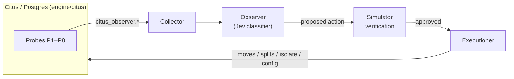

# Smart Sharding

Citus 14.2 on Postgres 18, with an LLM control plane that watches the cluster from inside the engine and continuously re-shards it.

## Why

Static shard placement goes stale as workloads drift: a tenant turns into a whale, a SKU goes hot, a flash sale spikes one shard group. Rebalancing in Citus today is manual and reactive. Smart Sharding closes the loop: observe the engine, decide what to change, verify it, and execute it.

## Architecture



### 1. Engine collector

Probes are instrumented directly inside Citus and Postgres. Counters live in shared memory, events go into a sequenced ring buffer, and a poller drains both. Everything is exposed as `citus_observer.*` SQL functions.

| Probe | Measures |
|-------|----------|
| P1 | Per-task execution stats |
| P2 | Per-shard resource use (executor hooks) |
| P3 | Planner decisions and missed routing |
| P4 | Hot-key sketches |
| P5 | Distributed transaction tracing / co-access |
| P6 | Lock contention (sampler background worker) |
| P7 | WAL change summaries (decoder) |
| P8 | Shard-operation phases and topology events |

Overhead budget with all probes on: **< 2% throughput loss** and **< 3% p99 latency increase**, measured A/B with the simulator as load generator.

### 2. Observer / control plane

The orchestrator. It reads the collector, classifies cluster state with Jev (a typed classifier), proposes an action, verifies it in the simulator, and hands approved actions to the executioner.

### 3. Executioner

Applies approved actions against Citus: shard moves, splits, tenant isolation, config changes, and colocation changes.

### The simulator

`sim/` (shardsim) generates load and provides ground truth for evaluation. **Simulator data is never a controller input.** The controller only sees what the engine probes report.

Current scenarios: `steady`, `black_friday`, `flash_spike`, `hot_sku`, `mix_drift`, `onboarding_wave`, `whale_emerges`.

## Repo layout

```
engine/citus/   Citus fork (git submodule, branch smart-sharding/v14.2.0)
sim/            shardsim load generator and tests
runs/           simulator run outputs (DuckDB)
```

## Getting started

```sh
git clone --recurse-submodules <this repo>
```

The Citus fork (`rnaji0/citus`) is private, so you need access to it for the submodule to clone.

Build and run instructions will be added as each component lands.

## Roadmap

- [ ] `feat/engine-collector`: probes P1–P8 and poller
- [ ] `feat/observer-control-plane`: Jev-driven orchestration and sim verification
- [ ] `feat/executioner`: executing approved actions against Citus

## License

Citus is licensed under AGPL-3.0. License for this project: TBD.
