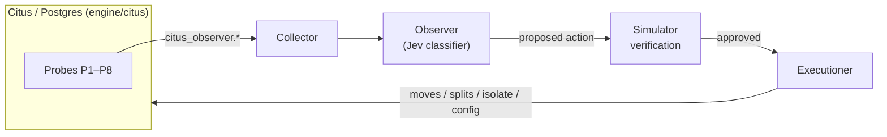

# Smart Sharding

Citus 14.2 on Postgres 18, with an LLM control plane that watches the cluster from inside the engine and continuously re-shards it.

## Why

Static shard placement goes stale as workloads drift: a tenant turns into a whale, a SKU goes hot, a flash sale spikes one shard group. Rebalancing in Citus today is manual and reactive. Smart Sharding closes the loop: observe the engine, decide what to change, verify it, and execute it.

## Architecture



### 1. Engine collector

Probes are instrumented directly inside Citus and Postgres. Counters live in shared memory, events go into a sequenced ring buffer, and a poller drains both. Everything is exposed as `citus_observer.*` SQL functions.

| Probe | Measures |
|-------|----------|
| P1 | Per-task execution stats |
| P2 | Per-shard resource use (executor hooks) |
| P3 | Planner decisions and missed routing |
| P4 | Hot-key sketches |
| P5 | Distributed transaction tracing / co-access |
| P6 | Lock contention (sampler background worker) |
| P7 | WAL change summaries (decoder) |
| P8 | Shard-operation phases and topology events |

Overhead budget with all probes on: **< 2% throughput loss** and **< 3% p99 latency increase**, measured A/B with the simulator as load generator.

#### Engine collector status

The Citus fork (`engine/citus`, branch `smart-sharding/v14.2.0` of `rnaji0/citus`) adds the `citus_observer` extension: per-task and per-shard execution statistics, planner decisions and column usage, hot primary keys, distributed transaction traces with shard-group/tenant co-access, sampled lock contention resolved to rows, per-tenant row changes decoded from the WAL, and shard move/split phase events. `engine/collector` polls all of it, plus stock Citus/Postgres views, into DuckDB.

```sh
make engine-deploy     # build the image from the fork and restart the cluster
make engine-test-c     # sketch and event ring unit tests
make collector-test    # collector unit tests
make engine-test-sql   # citus_observer integration tests (running cluster)
make collector-run ARGS="--duration 60"
```

##### Overhead: budget not met yet

Budget: under 2% throughput loss and under 3% p99 increase with every area on. Measured with `engine/bench/overhead.py` (3 off/on pairs, 60 s each, simulator as load generator; "on" includes change capture and the collector polling every 5 s), on a laptop Docker cluster (coordinator + 3 workers):

| Load | Metric | Off | On | Change |
|---|---|---|---|---|
| Light, ~100 txn/s | throughput | 100.4 txn/s | 100.9 txn/s | +0.5% |
| | p99 | 1070 ms | 262 ms | inconclusive: off runs alone ranged 68–2066 ms |
| Saturating, 3× offered | throughput | 519.9 txn/s | 447.4 txn/s | −13.9% raw |
| | p99 | 998 ms | 1540 ms | +54% raw |

Every saturation run was about 15% slower than the one before it, whichever arm it was (577 → 531 → 535 → 449 → 448 → 362 txn/s), so the raw numbers mostly measure drift. Comparing each "on" run with the mean of the "off" runs around it gives **−4.5% and −8.6% throughput**: over budget, but not measured precisely.

Open problems:

1. **The benchmark drifts.** Throughput falls run over run at saturation; the cause (data growth, bloat, thermal throttling) is unknown. Needs ABBA ordering, data reset or a non-growing workload, and longer runs before numbers can be trusted.
2. **Engine and collector cost are not separated.** "On" bundles the in-engine recording with the collector's polling. Each area (`citus_observer.track_*`) and the collector need their own arm.
3. **Likely costs to tune once measured:**
   - the contention sampler reads the whole lock table every 20 ms on every node;
   - every distributed transaction writes a `txn` event under one exclusive lock (`citus_observer.txn_event_sample_rate` defaults to 1.0);
   - the collector reads `citus_shards` (shard sizes from every node) and decodes the WAL each poll.

Not yet verified: bringing up a fresh cluster with `make reset` (the running cluster had the extension added by hand).

### 2. Observer / control plane

The orchestrator. It reads the collector, classifies cluster state with Jev (a typed classifier), proposes an action, verifies it in the simulator, and hands approved actions to the executioner.

### 3. Executioner

Applies approved actions against Citus: shard moves, splits, tenant isolation, config changes, and colocation changes.

### The simulator

`sim/` (shardsim) generates load and provides ground truth for evaluation. **Simulator data is never a controller input.** The controller only sees what the engine probes report.

Current scenarios: `steady`, `black_friday`, `flash_spike`, `hot_sku`, `mix_drift`, `onboarding_wave`, `whale_emerges`.

## Repo layout

```
engine/citus/   Citus fork (git submodule, branch smart-sharding/v14.2.0)
sim/            shardsim load generator and tests
runs/           simulator run outputs (DuckDB)
```

## Getting started

```sh
git clone --recurse-submodules <this repo>
```

The Citus fork (`rnaji0/citus`) is private, so you need access to it for the submodule to clone.

Build and run instructions will be added as each component lands.

## Roadmap

- [ ] `feat/engine-collector`: probes P1–P8 and poller
- [ ] `feat/observer-control-plane`: Jev-driven orchestration and sim verification
- [ ] `feat/executioner`: executing approved actions against Citus

## License

Citus is licensed under AGPL-3.0. License for this project: TBD.
